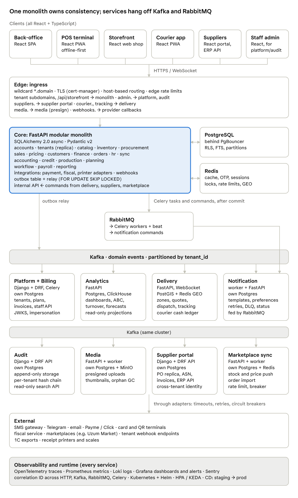

# Retail SaaS: slice-based roadmap

Nov 11, 2026 · @Asilbek Yunusov

## How this roadmap works

The destination is the same system as the original v7 roadmap; only the order changes. Instead of stages, the project grows in **slices**: one small user flow that works end to end. A slice adds only the models, tables and technology its flow needs. A new technology arrives only after its **trigger**, a problem you have measured or reproduced.

Every slice runs the same loop:

1. **Flow.** Who does what, and what the result is, in one sentence.
2. **Simplest solution.** The minimum code for this flow. Nothing is prepared for later slices.
3. **Break it or measure it.** A failing test, parallel requests, Locust or `EXPLAIN` makes the problem visible.
4. **Fix.** The smallest change that solves the measured problem.
5. **Write it down.** A short ADR (problem, decision, alternative, cost); before/after numbers in the README.

Each slice lists:

- **Trigger:** the observable situation that justifies the work. If it hasn't happened yet, the work waits.
- **Builds:** what gets added, in the original roadmap's stack and module names.
- **Learn:** the concepts this slice teaches naturally.
- **Done when:** the test or measurement that proves the slice is finished.
- `[later]`: optional depth inside the slice, picked up after the main flow works.

Under each slice heading, **Know first** lists what to understand before you start, with a specific chapter, doc page, article or talk. Short names: **DDIA** = *Designing Data-Intensive Applications*, 1st ed. (Kleppmann); **Cosmic Python** = *Architecture Patterns with Python*, free at [cosmicpython.com](https://www.cosmicpython.com/).

Full specs for every slice (files, models, endpoints, steps, tests) are in the Slice specs files (`01` conventions, `02`–`10` one file per phase).

The original roadmap is not thrown away. It becomes the **concept backlog**: after every slice, check it for concepts that now arrive naturally. The mapping table at the end shows where each original stage landed.

## Rules fixed from day one

These rules don't wait for a trigger: fixing them later means a data migration, and that lesson isn't worth its price. Everything else (CI, cache, brokers, Docker artifacts, Kubernetes) is a two-way door and arrives when it hurts.

| Rule                                                                         | Why from the start                                | Cost of fixing it later                               |
|------------------------------------------------------------------------------|---------------------------------------------------|-------------------------------------------------------|
| Money is `Decimal` or an integer amount in tiyin                             | `float` rounding errors leak into every report    | Migrating every money column and historical amount    |
| Times are UTC and timezone-aware                                             | Naive times mix with each tenant's time zone      | Re-interpreting every timestamp                       |
| Every business table has `tenant_id`                                         | The column is free while there is one tenant      | Adding the column to every table and backfilling rows |
| A sale and its stock change share one ACID transaction                       | Asynchronous stock is how overselling starts      | Rewriting the sale path                               |
| Completed documents are never edited, only corrected                         | The accounting history stays trustworthy          | Deleted history can't be recovered                    |
| Every balance comes from a ledger                                            | Each change leaves an immutable entry             | Creating opening entries for existing balances        |
| A sale line snapshots price, cost and tax                                    | Later price changes never break old sales         | The real historical prices are lost                   |
| Modules keep the target layout: router, schemas, service, repository, models | Matches the modular monolith you will split later | Moving code between folders across the whole project  |

The `tenant_id` column exists from day one, but filtering on it and RLS arrive only when the second tenant appears (slice 7).

## Target architecture

The final system is unchanged from the original roadmap: a FastAPI modular monolith owns everything that must be strongly consistent, RabbitMQ carries work, Kafka carries facts, and services own their own databases. Only the arrival order changes. Every frontend is a React + TypeScript app that talks to the backends only through their APIs: back-office, POS terminal, staff admin for Platform and Audit, storefront, courier app and supplier portal.

Editable version: `11 Architecture diagram.excalidraw` (open at https://excalidraw.com).

The core writes domain events to its outbox in the same transaction and the relay publishes them to Kafka; RabbitMQ carries Celery tasks and notification commands. The data and ML platform (Phase I) reads the same Kafka events plus CDC and is not drawn here. The table below says which slice brings each part.

| Component                    | Stack                                                | Arrives in slice |
|------------------------------|------------------------------------------------------|------------------|
| Core monolith                | FastAPI, SQLAlchemy 2.0 async, Pydantic v2, Alembic  | 1                |
| PostgreSQL                   | RLS 7, partitions 16, PgBouncer 19                   | 1                |
| Back-office UI               | React + TypeScript SPA (Vite)                        | 8                |
| Redis                        | sessions 8, rate limits 13, cache 17                 | 8                |
| Logs, correlation ID, Sentry | structlog                                            | 14               |
| RabbitMQ + Celery            | workers, beat                                        | 18               |
| POS terminal                 | React + TypeScript PWA, IndexedDB                    | 25               |
| Outbox + Kafka               | relay with `SKIP LOCKED`, partitioned by `tenant_id` | 27               |
| Integration adapters         | payment, fiscal, SMS, printer, outbound webhooks     | 28               |
| Notification service         | worker + FastAPI, own Postgres                       | 29               |
| Platform and Billing         | Django + DRF, Celery                                 | 30               |
| Analytics service            | FastAPI, Postgres, ClickHouse `[later]`              | 31               |
| Storefront API               | inside the monolith                                  | 32               |
| Delivery service             | FastAPI, PostGIS, Redis GEO, WebSocket               | 33               |
| Tracing, metrics, dashboards | OpenTelemetry, Prometheus, Grafana, Loki             | 34               |
| Kubernetes, ingress, CD      | Helm, cert-manager, GitHub Actions                   | 35               |
| Audit service                | Django + DRF                                         | 36               |
| Media service                | FastAPI + worker, MinIO                              | 37               |
| Supplier portal              | Django + DRF API, React UI                           | 38               |
| Marketplace sync             | FastAPI + worker                                     | 39               |
| Data platform                | Debezium, Iceberg on MinIO, Airflow, dbt, Spark      | 48–51            |
| ML serving                   | FastAPI, MLflow                                      | 53               |
| Assistant                    | FastAPI, pgvector, LLM adapter                       | 55               |

## Phase A: one store, one till

One seeded tenant and location, no auth yet. The goal is a correct sale before anything else.

| \#  | Slice                                | Trigger                               | Builds                                                                                                               | Stage   |
|-----|--------------------------------------|---------------------------------------|----------------------------------------------------------------------------------------------------------------------|---------|
| 1   | Cashier sells a product by barcode   | First flow                            | App factory, lifespan, settings, async session, Alembic, `Product`, `Barcode`, `Sale`, pytest, Compose with Postgres | 0, 2, 5 |
| 2   | Stock goes down and never below zero | Two parallel sales oversell in a test | Stock ledger, `StockLevel`, `CHECK`, reconciliation, row lock ordered by `variant_id`                                | 3, 5    |
| 3   | A retried request doesn't sell twice | Double click writes two sales         | `Idempotency-Key`, stored response, `409` on a changed payload                                                       | 5       |
| 4   | Pay, get change, print a receipt     | Real checkout                         | Cash, card, split payment, VAT snapshot, gapless receipt number                                                      | 5       |
| 5   | Open and close a shift               | Cash in the drawer doesn't match      | Shift, cash in/out, X and Z reports                                                                                  | 5       |
| 6   | Refund, void, exchange               | Customer brings an item back          | Refund against receipt, parallel refund test, void, exchange                                                         | 5       |

### 1 · Cashier sells a product by barcode

**Know first**

- App lifecycle and dependency injection: FastAPI [Lifespan events](https://fastapi.tiangolo.com/advanced/events/), [Dependencies](https://fastapi.tiangolo.com/tutorial/dependencies/), [Bigger applications](https://fastapi.tiangolo.com/tutorial/bigger-applications/)
- Async sessions and transactions: SQLAlchemy 2.0 [Asyncio](https://docs.sqlalchemy.org/en/20/orm/extensions/asyncio.html), [Transactions](https://docs.sqlalchemy.org/en/20/orm/session_transaction.html)
- Repository, service layer, Unit of Work: Cosmic Python [ch. 2](https://www.cosmicpython.com/book/chapter_02_repository.html), [ch. 4](https://www.cosmicpython.com/book/chapter_04_service_layer.html), [ch. 6](https://www.cosmicpython.com/book/chapter_06_uow.html)
- Money as `Decimal`: [Python `decimal`](https://docs.python.org/3/library/decimal.html); fixtures and scopes: [pytest fixtures](https://docs.pytest.org/en/stable/how-to/fixtures.html)

**Checklist**

- [ ] Repo, branch protection, conventional commits
- [ ] `uv`, `pyproject.toml`, lock file
- [ ] Pydantic Settings, UTC timezone-aware times
- [ ] Async SQLAlchemy engine and session, Alembic, Unit of Work foundation
- [ ] Application factory and lifespan that opens and closes the engine
- [ ] Module layout `modules/catalog`, `modules/sales`: router, schemas, service, repository, models
- [ ] `Product` (name, `Decimal` price, `tenant_id`) and `Barcode` table, unique per tenant
- [ ] `Sale` + `SaleLine` with a price snapshot; states `draft → completed`
- [ ] Endpoints: create draft, add line by barcode, complete; the sale service commits through the Unit of Work
- [ ] Compose with Postgres; pytest async + httpx; one integration test of the whole flow
- [ ] ADR: modular monolith; repository and Unit of Work

### 2 · Stock goes down and never below zero

**Know first**

- Lost updates and `SELECT ... FOR UPDATE`: DDIA ch. 7, "Preventing lost updates"
- Row locks and deadlocks: [PostgreSQL: Explicit locking](https://www.postgresql.org/docs/current/explicit-locking.html)
- Balance as a sum of immutable entries: DDIA ch. 11, "State, streams, and immutability"
- [PostgreSQL: Constraints](https://www.postgresql.org/docs/current/ddl-constraints.html) (`CHECK`)

**Checklist**

- [ ] `StockMovement` ledger (immutable): `receive`, `sale`, `adjustment`
- [ ] `StockLevel` (location × variant) with `CHECK (on_hand >= 0)`
- [ ] Initial stock enters through a `receive` movement (procurement comes later)
- [ ] Completion in one transaction: lock stock rows ordered by `variant_id` → decrement → movements → `completed`
- [ ] Test: two parallel sales of the last item, first without a lock (it oversells), then with `with_for_update`
- [ ] Reconciliation check: `on_hand` equals the sum of movements
- [ ] ADR: row lock vs atomic `UPDATE ... WHERE on_hand >= :qty`

### 3 · A retried request doesn't sell twice

**Know first**

- [Brandur: Implementing Stripe-like idempotency keys in Postgres](https://brandur.org/idempotency-keys)
- [AWS Builders' Library: Making retries safe with idempotent APIs](https://aws.amazon.com/builders-library/making-retries-safe-with-idempotent-APIs/)
- Unique constraints as the race-proof check: `ON CONFLICT` in [PostgreSQL: INSERT](https://www.postgresql.org/docs/current/sql-insert.html)

**Checklist**

- [ ] `Idempotency-Key` header on sale completion
- [ ] Stored response with a TTL (a Postgres table first)
- [ ] Same key and payload → stored response; same key, different payload → `409`
- [ ] Test: the same request sent twice in parallel writes one sale

### 4 · Pay, get change, print a receipt

**Know first**

- Rounding modes (`ROUND_HALF_UP` vs banker's rounding): [Python `decimal`](https://docs.python.org/3/library/decimal.html)
- Why sequences have gaps: [PostgreSQL: CREATE SEQUENCE](https://www.postgresql.org/docs/current/sql-createsequence.html), Notes section
- VAT included vs added, and line vs receipt rounding: the VAT chapter of the current Tax Code of Uzbekistan
- QR codes in Python: [`qrcode`](https://pypi.org/project/qrcode/)

**Checklist**

- [ ] Cash (tendered, change) and card (terminal reference)
- [ ] Split payment; completion requires `sum(payments) == total`
- [ ] VAT included or added, rate per product, rounding rule (ADR), snapshot on the line
- [ ] Manual discount with a maximum percent (manager approval comes in slice 9)
- [ ] Gapless receipt number per location: counter row with `with_for_update`; measure the cost
- [ ] Receipt as printer text, plus a link with a QR code
- [ ] Hold and resume a draft sale; hold expiry

### 5 · Open and close a shift

**Know first**

- Documents as aggregates with a state machine: Cosmic Python [ch. 7](https://www.cosmicpython.com/book/chapter_07_aggregate.html)
- Shift domain (opening float, cash in/out, X vs Z report): the shift and cash management pages in any POS vendor's help center (Loyverse, Square)
- Report queries: `GROUP BY` and `FILTER` in [PostgreSQL: Aggregate functions](https://www.postgresql.org/docs/current/functions-aggregate.html)

**Checklist**

- [ ] `Shift`: open with opening cash, close with counted cash
- [ ] Cash in and cash out
- [ ] Expected vs counted difference; X report (mid-shift) and Z report (close)
- [ ] A sale requires an open shift

### 6 · Refund, void, exchange

**Know first**

- Correcting with new documents instead of edits: [Square: Books, an immutable double-entry accounting database](https://developer.squareup.com/blog/books-an-immutable-double-entry-accounting-database-service/)
- "Never more than sold" under concurrency: DDIA ch. 7, "Write skew and phantoms"
- Splitting money without losing tiyin: [Largest remainder method](https://en.wikipedia.org/wiki/Largest_remainder_method)

**Checklist**

- [ ] Refund against the original receipt: partial lines and quantities
- [ ] Never more than sold minus earlier refunds; parallel refund test
- [ ] Refund to the original payment method; back to stock or written off as damaged
- [ ] Void: cancel a draft, or reverse a completed sale within the same shift
- [ ] Exchange = a linked refund + a new sale; the difference is paid or refunded
- [ ] Receipt duplicate marked "DUPLICATE"

## Phase B: tenants, staff and catalog

| \#  | Slice                        | Trigger                                | Builds                                                                                                             | Stage |
|-----|------------------------------|----------------------------------------|--------------------------------------------------------------------------------------------------------------------|-------|
| 7   | A second shop joins          | A leak test shows shop B's sales       | `Tenant`, `Domain`, tenant middleware, `contextvars`, global filter, RLS `FORCE`                                   | 1     |
| 8   | Staff log in                 | Anyone can call any endpoint           | `User`, `Membership`, Argon2, Redis session + React back-office, JWT for the POS                                   | 1     |
| 9   | A cashier can't refund alone | Cashier refunds without a manager      | Permission codes (only existing ones), roles as data, permission dependency, location access, manager PIN approval | 1, 5  |
| 10  | The catalog grows            | 5,000 seeded products, search is slow  | Categories, variants, price lists, location prices, price history, barcode → SKU → trigram search, scale barcodes  | 2     |
| 11  | Stock moves between places   | A second location and a physical count | Adjustments, stock counts, transfers with in-transit stock, holds as reservations                                  | 3     |

### 7 · A second shop joins

**Know first**

- Tenancy models and RLS in practice: [AWS: Multi-tenant data isolation with PostgreSQL Row Level Security](https://aws.amazon.com/blogs/database/multi-tenant-data-isolation-with-postgresql-row-level-security/)
- [PostgreSQL: Row security policies](https://www.postgresql.org/docs/current/ddl-rowsecurity.html) (`ENABLE` vs `FORCE`)
- Global filter: SQLAlchemy [Session events](https://docs.sqlalchemy.org/en/20/orm/session_events.html), section "Adding global WHERE / ON criteria"
- Request-scoped state in async code: [Python `contextvars`](https://docs.python.org/3/library/contextvars.html)

**Checklist**

- [ ] `Tenant`, `Domain`, subdomain validation
- [ ] Tenant-resolving middleware; the tenant lives in `contextvars`
- [ ] Leak test first: shop B reads shop A's sales (it fails)
- [ ] SQLAlchemy global filter that fails closed when no tenant is set
- [ ] DB roles; RLS `ENABLE` + `FORCE`; RLS coverage test for every table
- [ ] `Location` (store or warehouse); tenant settings: currency, time zone, tax regime, receipt format
- [ ] Internal CLI to create a tenant as an idempotent command, run with a separate RLS-bypass role
- [ ] `404` for another tenant's or location's objects

### 8 · Staff log in

**Know first**

- [OWASP Password Storage Cheat Sheet](https://cheatsheetseries.owasp.org/cheatsheets/Password_Storage_Cheat_Sheet.html) (Argon2id)
- [OWASP Session Management Cheat Sheet](https://cheatsheetseries.owasp.org/cheatsheets/Session_Management_Cheat_Sheet.html)
- JWT: [RFC 7519](https://datatracker.ietf.org/doc/html/rfc7519); [Auth0: Refresh token rotation](https://auth0.com/docs/secure/tokens/refresh-tokens/refresh-token-rotation)
- [FastAPI: Middleware](https://fastapi.tiangolo.com/tutorial/middleware/); [react.dev: Learn](https://react.dev/learn); [TanStack Query](https://tanstack.com/query/latest); cookie sessions from a SPA: [OWASP CSRF Cheat Sheet](https://cheatsheetseries.owasp.org/cheatsheets/Cross-Site_Request_Forgery_Prevention_Cheat_Sheet.html)

**Checklist**

- [ ] Global `User` (phone in E.164) + `Membership` per tenant
- [ ] Argon2 password hashing; auth written by hand, no library
- [ ] Back-office: Redis server-side session in an HttpOnly cookie; React + TypeScript app (Vite) with login and sale list pages, API client generated from OpenAPI
- [ ] POS: JWT access + refresh, rotation, reuse detection, tenant claim check
- [ ] API standards: one error format, `/api/v1/`, OpenAPI docs
- [ ] Middleware order: correlation ID → tenant → auth → error handler
- [ ] ADR: session vs JWT; access vs refresh token lifetimes; ASGI and blocking calls
- [ ] Invites; append-only audit log

### 9 · A cashier can't refund alone

**Know first**

- Deny by default, object-level checks, RBAC vs ABAC: [OWASP Authorization Cheat Sheet](https://cheatsheetseries.owasp.org/cheatsheets/Authorization_Cheat_Sheet.html)
- Step-up (re)authentication: [OWASP Authentication Cheat Sheet](https://cheatsheetseries.owasp.org/cheatsheets/Authentication_Cheat_Sheet.html)
- A permission as an endpoint dependency: [FastAPI: Dependencies](https://fastapi.tiangolo.com/tutorial/dependencies/)

**Checklist**

- [ ] Permission codes in code, only for existing features: `sale.create`, `sale.refund`, `sale.void`, `sale.discount.manual`, `product.update_price`
- [ ] `Role` as tenant data; default roles seeded for every tenant
- [ ] Permission dependency per endpoint; location-level access
- [ ] Manager approval: request → manager PIN on the same terminal → single-use token bound to the operation and amount, valid 2 minutes
- [ ] PIN hashed with an attempt limit; audit of who requested, who approved and why
- [ ] Role × permission × endpoint matrix test
- [ ] `[later]` tenant-made roles with privilege escalation protection; ADR RBAC vs ABAC

### 10 · The catalog grows

**Know first**

- How B-tree indexes work: [Use The Index, Luke](https://use-the-index-luke.com/), chapters 1–2; trigram search: [pg_trgm](https://www.postgresql.org/docs/current/pgtrgm.html)
- Data models (relational vs document, EAV vs JSONB): DDIA ch. 2; [PostgreSQL: JSON types](https://www.postgresql.org/docs/current/datatype-json.html)
- Trees in SQL: [ltree](https://www.postgresql.org/docs/current/ltree.html)
- Barcodes: [GS1: How to calculate a check digit](https://www.gs1.org/services/how-calculate-check-digit-manually)

**Checklist**

- [ ] Seed 5,000 products and measure search before changing anything
- [ ] `Category` tree (ADR: adjacency list, materialized path, `ltree`), `Brand`
- [ ] `Product` + `ProductVariant` as the sellable SKU; attributes (ADR: EAV, JSONB, separate tables)
- [ ] Several barcodes per variant with a type; units; weighted quantity `Decimal(12, 3)`
- [ ] Scale barcode parsing and EAN-13 check digit; QR scans routed to barcode search
- [ ] `PriceList` + items: retail, wholesale, location prices, price history; price changes audited
- [ ] Search order: barcode → SKU → name (`pg_trgm`); barcode lookup under 10 ms
- [ ] Archiving: a sold product is never hard-deleted
- [ ] `[later]` bundles, kits, serial and batch tracking

### 11 · Stock moves between places

**Know first**

- Document state machines and approvals: Cosmic Python [ch. 7](https://www.cosmicpython.com/book/chapter_07_aggregate.html)
- Reservations as a race condition: DDIA ch. 7, "Write skew and phantoms" (materializing conflicts)
- Stock counting practice: [Cycle count](https://en.wikipedia.org/wiki/Cycle_count)

**Checklist**

- [ ] Adjustments with reasons; above a set amount they need approval
- [ ] Stock count session (full and cycle count), snapshot + deltas while selling, variance → approval → adjustments
- [ ] Transfer: request → approval → picking → shipped (in transit) → received; partial receipt and discrepancies
- [ ] `reserved` and `available`; held sales reserve stock with an expiry (the release job arrives in slice 18)
- [ ] Parallel reservations never exceed `available`
- [ ] Minimum stock and low-stock flag; movement history with filters
- [ ] `[later]` bins, put-away, picking routes, FEFO

## Phase C: production

This is where CI, Docker images and security stop being theory: something real is online.

| \#  | Slice                           | Trigger                      | Builds                                                                                                                                                  | Stage  |
|-----|---------------------------------|------------------------------|---------------------------------------------------------------------------------------------------------------------------------------------------------|--------|
| 12  | The app runs on a VPS           | Nothing is deployed anywhere | Multi-stage Dockerfile, Compose in prod, liveness/readiness; CI (lint, mypy, tests, migration check, image tagged by SHA) after the first broken deploy | 0, 21  |
| 13  | The app is safe on the internet | It is public                 | Rate limiting, CSRF, security headers, CSP, phone OTP, TOTP for owners                                                                                  | 1      |
| 14  | A production bug can be traced  | A bug you can't reproduce    | Structured logs, correlation ID, Sentry                                                                                                                 | 13, 20 |

### 12 · The app runs on a VPS

**Know first**

- [Docker: Multi-stage builds](https://docs.docker.com/build/building/multi-stage/); [FastAPI in containers](https://fastapi.tiangolo.com/deployment/docker/)
- Config, processes, dev/prod parity: [The Twelve-Factor App](https://12factor.net/)
- CI: [GitHub Actions docs](https://docs.github.com/en/actions); [Testcontainers for Python](https://testcontainers-python.readthedocs.io/)
- [Martin Fowler: The practical test pyramid](https://martinfowler.com/articles/practical-test-pyramid.html); TLS reverse proxy: [Caddy docs](https://caddyserver.com/docs/)

**Checklist**

- [ ] Multi-stage Dockerfile, non-root user, the app built as a wheel
- [ ] Production Compose: app, Postgres, Redis, reverse proxy with TLS
- [ ] Liveness and readiness endpoints; Compose healthchecks
- [ ] Migrations run as a separate step before the app starts
- [ ] Postgres backups and one tested restore
- [ ] CI after the first broken deploy: ruff, mypy, pytest with Testcontainers, Alembic migration check
- [ ] Docker image tagged by commit SHA; the deploy pulls that tag
- [ ] pre-commit hooks; `tests/README.md` with the test pyramid

### 13 · The app is safe on the internet

**Know first**

- [OWASP Top 10](https://owasp.org/www-project-top-ten/)
- OWASP cheat sheets: [CSRF](https://cheatsheetseries.owasp.org/cheatsheets/Cross-Site_Request_Forgery_Prevention_Cheat_Sheet.html), [CSP](https://cheatsheetseries.owasp.org/cheatsheets/Content_Security_Policy_Cheat_Sheet.html), [HTTP headers](https://cheatsheetseries.owasp.org/cheatsheets/HTTP_Headers_Cheat_Sheet.html), [MFA](https://cheatsheetseries.owasp.org/cheatsheets/Multifactor_Authentication_Cheat_Sheet.html)
- TOTP: [RFC 6238](https://datatracker.ietf.org/doc/html/rfc6238)
- Rate limiter algorithms: Alex Xu, *System Design Interview* vol. 1, ch. 4 "Design a rate limiter"

**Checklist**

- [ ] Sliding-window rate limiting in Redis on login and OTP
- [ ] CSRF for cookie sessions; security headers; `Content-Security-Policy`; CORS with an explicit origin list
- [ ] SQL injection test with hostile input; parametrised queries only
- [ ] Phone OTP: hashed, TTL, attempt limit, cooldown, atomic check, enumeration protection
- [ ] TOTP 2FA for owners and managers
- [ ] Least privilege for DB roles and token scopes

### 14 · A production bug can be traced

**Know first**

- [structlog docs](https://www.structlog.org/); [Sentry for Python](https://docs.sentry.io/platforms/python/)
- Logs vs metrics vs traces: Sam Newman, *Building Microservices* 2nd ed., ch. 10 "From monitoring to observability"

**Checklist**

- [ ] structlog JSON logs with correlation ID, tenant and user; no personal data
- [ ] Correlation ID returned in a response header and shown on error pages
- [ ] Sentry for exceptions, release = commit SHA
- [ ] Runbook: from a user's report to the request's logs

## Phase D: load, performance and background work

Measure first, then fix. Cache and Celery come after the numbers that justify them. This phase comes before the business domain because the goal is a middle+ job: after slice 19, the original "job-ready" level is covered. Update your resume and start applying.

| \#  | Slice                                  | Trigger                                          | Builds                                                                                                            | Stage |
|-----|----------------------------------------|--------------------------------------------------|-------------------------------------------------------------------------------------------------------------------|-------|
| 15  | 50 cashiers sell at once               | Locust shows errors or deadlocks                 | Deadlock fix with retries, pessimistic vs optimistic locking, isolation level lab, ACID walkthrough               | 5     |
| 16  | Reports stay fast on 10M lines         | Seeded reports take seconds                      | `EXPLAIN ANALYZE`, indexes, N+1 counter, cursor pagination, monthly partitions, summary tables, `py-spy`/`memray` | 10    |
| 17  | Hot reads stop hitting Postgres        | Profiling shows repeated price and catalog reads | Redis cache-aside, invalidation, stampede protection, hit ratio metric                                            | 9     |
| 18  | Slow work leaves the request           | A 100,000-row import times out                   | RabbitMQ + Celery, after-commit dispatch, retries, DLQ, upsert import, beat for expiries                          | 9     |
| 19  | The database survives many connections | Pool exhaustion under load                       | PgBouncer, pool settings, full-text search in Latin, Cyrillic and Russian                                         | 10    |

### 15 · 50 cashiers sell at once

**Know first**

- Isolation levels and anomalies: DDIA ch. 7; [PostgreSQL: Transaction isolation](https://www.postgresql.org/docs/current/transaction-iso.html); [Kleppmann: Hermitage](https://martin.kleppmann.com/2014/11/25/hermitage-testing-the-i-in-acid.html)
- MVCC and locks inside Postgres: Rogov, [PostgreSQL 14 Internals](https://postgrespro.com/community/books/internals) (free), Part I "Isolation and MVCC" and Part III "Locks"
- Talk: [Kleppmann, "Transactions: myths, surprises and opportunities"](https://martin.kleppmann.com/2015/09/26/transactions-at-strange-loop.html) (Strange Loop 2015, video on the page)
- [Locust quickstart](https://docs.locust.io/en/stable/quickstart.html)

**Checklist**

- [ ] Locust scenario: 50 cashiers selling overlapping products
- [ ] Cause a deadlock on purpose; fix with lock ordering and retry on deadlock
- [ ] Pessimistic (`with_for_update`) vs optimistic (version column): implement both, measure, keep one (ADR)
- [ ] Isolation lab: lost update, non-repeatable read and phantom at `READ COMMITTED` and `REPEATABLE READ`; the sale under `SERIALIZABLE` with retry
- [ ] ACID on the sale: savepoint when a payment adapter fails, constraints, what `COMMIT` waits for (WAL)
- [ ] Results in the README

### 16 · Reports stay fast on 10M lines

**Know first**

- Storage engines and indexes: DDIA ch. 3; [Use The Index, Luke](https://use-the-index-luke.com/)
- [PostgreSQL: Using EXPLAIN](https://www.postgresql.org/docs/current/using-explain.html), [Indexes](https://www.postgresql.org/docs/current/indexes.html), [Partitioning](https://www.postgresql.org/docs/current/ddl-partitioning.html), [Window functions](https://www.postgresql.org/docs/current/tutorial-window.html)
- N+1 and eager loading: [SQLAlchemy: Relationship loading techniques](https://docs.sqlalchemy.org/en/20/orm/queryguide/relationships.html)
- Profilers: [py-spy](https://github.com/benfred/py-spy), [memray](https://github.com/bloomberg/memray)

**Checklist**

- [ ] Seed 10M+ sale lines with one very large tenant
- [ ] `EXPLAIN (ANALYZE, BUFFERS)` and `pg_stat_statements`; composite, partial, covering, BRIN and GIN indexes
- [ ] SQL lab: joins, `EXISTS`, window functions, `FILTER`; one report written three ways
- [ ] Query counter in tests for N+1; `selectinload` / `joinedload`; lazy loading set to `raise`
- [ ] Offset vs cursor pagination measured at page 10,000; filter and sort whitelist
- [ ] Monthly partitions for sales; summary tables or materialized views (ADR on denormalization)
- [ ] `py-spy` and `memray`: find one planted bottleneck and one leak
- [ ] `[later]` read replica and replication lag

### 17 · Hot reads stop hitting Postgres

**Know first**

- [AWS Builders' Library: Caching challenges and strategies](https://aws.amazon.com/builders-library/caching-challenges-and-strategies/)
- Cache-aside vs write-through, stampede, eviction (LRU, LFU): the Redis docs on caching and key eviction

**Checklist**

- [ ] Measure first: which reads repeat (catalog, prices, domains)
- [ ] Redis cache-aside with TTL and tenant prefix; invalidation on write (ADR vs write-through)
- [ ] Hit/miss ratio metric
- [ ] Stampede protection, eviction policy, warm-up after deploy, one tenant's hot price list
- [ ] Before/after numbers in the README

### 18 · Slow work leaves the request

**Know first**

- Message queues vs logs, at-least-once delivery: DDIA ch. 11, "Transmitting event streams"
- Celery [Tasks](https://docs.celeryq.dev/en/stable/userguide/tasks.html) (retries, `acks_late`) and [Periodic tasks](https://docs.celeryq.dev/en/stable/userguide/periodic-tasks.html); RabbitMQ [Acknowledgements](https://www.rabbitmq.com/docs/confirms) and [Dead letter exchanges](https://www.rabbitmq.com/docs/dlx)
- [AWS: Timeouts, retries and backoff with jitter](https://aws.amazon.com/builders-library/timeouts-retries-and-backoff-with-jitter/)
- Enqueue after commit: [Brandur: Transactionally staged job drains](https://brandur.org/job-drain); locks: [Kleppmann: How to do distributed locking](https://martin.kleppmann.com/2016/02/08/how-to-do-distributed-locking.html)

**Checklist**

- [ ] RabbitMQ + Celery worker and beat in Compose; sync SQLAlchemy session for workers (ADR vs arq, taskiq)
- [ ] Tasks carry `tenant_id` and are sent only after commit by the Unit of Work
- [ ] Retries with backoff and jitter, `acks_late`, idempotent tasks, separate queues, prefetch as backpressure, DLQ for poison messages
- [ ] Async product import (CSV/Excel) with progress, error report and upsert (`ON CONFLICT`)
- [ ] Bulk price update
- [ ] Beat jobs: release expired reservations, low-stock check
- [ ] OTP and invite sending moved into tasks
- [ ] Redis distributed lock for single-run jobs (ADR: why stock uses DB locks)
- [ ] `[later]` import progress over SSE; remote approval over WebSocket

### 19 · The database survives many connections

**Know first**

- [PgBouncer: Features and pooling modes](https://www.pgbouncer.org/features.html)
- [SQLAlchemy: Connection pooling](https://docs.sqlalchemy.org/en/20/core/pooling.html)
- [PostgreSQL: Full text search](https://www.postgresql.org/docs/current/textsearch.html)

**Checklist**

- [ ] Load until the pool runs out and record what breaks
- [ ] SQLAlchemy pool size, overflow and timeout tuned
- [ ] PgBouncer in transaction mode; `SET LOCAL` for the tenant; asyncpg prepared statement fix
- [ ] Full-text search: `tsvector` + `pg_trgm`, Uzbek Latin and Cyrillic, Russian, transliteration
- [ ] ADR: one very large tenant as a hotspot

## Phase E: business domain

| \#  | Slice                          | Trigger                                                      | Builds                                                                                                                    | Stage |
|-----|--------------------------------|--------------------------------------------------------------|---------------------------------------------------------------------------------------------------------------------------|-------|
| 20  | Goods arrive from suppliers    | Stock only enters through adjustments; cost is typed by hand | Suppliers, PO state machine, amount-based approval, goods receipt, WAC, supplier returns, payables ledger                 | 4     |
| 21  | Promotions apply automatically | Discount `if`s pile up in the sale service                   | Pure pricing engine, price resolution order, Buy X Get Y, happy hour, stacking, coupons, promo limits, `hypothesis` tests | 6     |
| 22  | Regular customers earn and owe | Customers ask for points and credit                          | `Customer`, groups, points ledger, store credit, credit limit with account lock                                           | 7     |
| 23  | The owner sees profit          | "How much did we earn?" has no answer                        | Payment ledger, expenses, COGS from snapshots, gross profit, AR/AP aging                                                  | 8     |
| 24  | A new cashier is hired         | Memberships are created by hand                              | `Employee`, hiring flow that creates a membership                                                                         | 11    |

### 20 · Goods arrive from suppliers

**Know first**

- Inventory costing (WAC vs FIFO), COGS: [AccountingCoach: Inventory and cost of goods sold](https://www.accountingcoach.com/inventory-and-cost-of-goods-sold/explanation)
- Payables as a ledger: [Modern Treasury: Accounting for developers](https://www.moderntreasury.com/journal/accounting-for-developers-part-i)
- Procure-to-pay flow and three-way matching (PO, receipt, invoice): any ERP procurement guide

**Checklist**

- [ ] `Supplier` with contacts and payment terms
- [ ] PO states `draft → pending_approval → approved → sent → partially_received → received → closed / cancelled`
- [ ] Approval by amount (`purchase.approve`)
- [ ] Goods receipt: partial, short and excess goods, batches and expiry dates, stock movements
- [ ] Weighted average cost recalculated on receipt with a lock for parallel receipts (ADR: WAC vs FIFO); sales now snapshot real cost
- [ ] Returns to supplier
- [ ] Payables ledger: invoice from receipt, partial payments, balance
- [ ] `[later]` purchase requests from reorder level, supplier performance, landed cost

### 21 · Promotions apply automatically

**Know first**

- [Refactoring.Guru: Strategy pattern](https://refactoring.guru/design-patterns/strategy)
- Pure core, effects at the edges: Gary Bernhardt, ["Boundaries" talk](https://www.destroyallsoftware.com/talks/boundaries)
- Property-based testing: [Hypothesis docs](https://hypothesis.readthedocs.io/)
- [Largest remainder method](https://en.wikipedia.org/wiki/Largest_remainder_method)

**Checklist**

- [ ] Pricing engine as a pure function: cart + rules in, prices out, no DB queries inside
- [ ] Price resolution order (ADR): customer price → location → customer group → retail
- [ ] `Promotion` conditions (products, category, brand, location, group, minimum, dates, weekdays, time) and benefits (percent, fixed, fixed price, free item)
- [ ] Buy X Get Y; happy hour in the tenant's time zone
- [ ] Stacking rules with a deterministic result
- [ ] Coupons and promo codes; limits with atomic `UPDATE ... WHERE used < limit`, returned on void
- [ ] Receipt discount allocated across lines (largest remainder)
- [ ] Applied promotions snapshotted on lines; `hypothesis` property tests

### 22 · Regular customers earn and owe

**Know first**

- Credit limit as write skew: DDIA ch. 7, "Write skew and phantoms"
- Points and store credit as liabilities in a ledger: [Modern Treasury: Accounting for developers](https://www.moderntreasury.com/journal/accounting-for-developers-part-i)

**Checklist**

- [ ] `Customer` (phone unique per tenant), groups, purchase history; attach to a sale
- [ ] Points ledger: earn, spend, expire, reversed on refund
- [ ] Store credit ledger: top-up, POS payment method, refunds to balance
- [ ] Customer credit with a limit; the account row is locked so two terminals can't exceed it
- [ ] Debt repayment; customer statement
- [ ] `[later]` cashback, birthday promotions, automatic points expiry

### 23 · The owner sees profit

**Know first**

- Debits, credits, AR and AP: [AccountingCoach: Debits and credits](https://www.accountingcoach.com/debits-and-credits/explanation)
- [Modern Treasury: Accounting for developers](https://www.moderntreasury.com/journal/accounting-for-developers-part-i)
- [PostgreSQL: Window functions](https://www.postgresql.org/docs/current/tutorial-window.html) for aging buckets

**Checklist**

- [ ] Payment transaction ledger: sales, refunds, supplier and customer payments, expenses
- [ ] Cash balance per location and shift
- [ ] Expenses with categories
- [ ] Revenue, COGS from sale snapshots, gross profit by period and location
- [ ] AR and AP aging: 0–30, 31–60, 61–90, 90+ days
- [ ] `[later]` cash flow report

### 24 · A new cashier is hired

**Know first**

- Side effects across modules (hired → membership): Cosmic Python [ch. 8](https://www.cosmicpython.com/book/chapter_08_events_and_message_bus.html)

**Checklist**

- [ ] `Employee` linked to `User` and `Membership`, with position and location
- [ ] Hiring state machine `candidate → interview → offer → hired`; on `hired`, a membership and role are created
- [ ] `[later]` schedules, attendance, cashier KPIs

## Phase F: offline POS and events

| \#  | Slice                                    | Trigger                                            | Builds                                                                                                         | Stage |
|-----|------------------------------------------|----------------------------------------------------|----------------------------------------------------------------------------------------------------------------|-------|
| 25  | A store keeps selling without internet   | The connection drops in a store                    | React + TS PWA, device registration, catalog snapshot and incremental sync, client UUID sales, conflict report | 12    |
| 26  | Modules stop reaching into each other    | Cross-module imports and JOINs block a clean split | `import-linter`, removing cross-module JOINs and FKs                                                           | 13    |
| 27  | Side effects after a sale are never lost | Receipts and notifications fail or slow the sale   | Transactional outbox, relay, event envelope and versions, inbox pattern, Kafka (RFC: Kafka vs RabbitMQ)        | 13    |

### 25 · A store keeps selling without internet

**Know first**

- [Ink & Switch: Local-first software](https://www.inkandswitch.com/local-first/)
- MDN: [Progressive web apps](https://developer.mozilla.org/en-US/docs/Web/Progressive_web_apps), [IndexedDB API](https://developer.mozilla.org/en-US/docs/Web/API/IndexedDB_API)
- [react.dev: Learn](https://react.dev/learn); [TypeScript handbook](https://www.typescriptlang.org/docs/handbook/intro.html)
- Clocks and conflicts: DDIA ch. 8 "Unreliable clocks"; DDIA ch. 5 "Handling write conflicts"

**Checklist**

- [ ] ADR: PWA + IndexedDB vs a small desktop app with SQLite
- [ ] React + TypeScript PWA with a service worker in `pos-terminal/`
- [ ] Device registration bound to a location, with device credentials
- [ ] Snapshot of catalog, prices, promotions and customers; incremental sync with `updated_since` and tombstones
- [ ] Offline sales with a client UUID; receipt numbers with a device prefix
- [ ] Pricing on the client: rules shared as data (ADR); offline policy for duration, amount, refunds and credit
- [ ] Client outbox, batch upload, retries; server idempotency and out-of-order batches in `modules/sync`
- [ ] Conflicts: negative stock, changed price, promo and credit limits, deleted product → conflict report
- [ ] Device time and server time stored separately; tests for network loss and duplicates

### 26 · Modules stop reaching into each other

**Know first**

- Coupling and abstractions: Cosmic Python [ch. 3](https://www.cosmicpython.com/book/chapter_03_abstractions.html)
- Bounded contexts: Vlad Khononov, *Learning Domain-Driven Design*, ch. 3
- [import-linter docs](https://import-linter.readthedocs.io/)

**Checklist**

- [ ] `import-linter` contracts for every module
- [ ] Modules call each other only through service interfaces
- [ ] Cross-module JOINs and FKs removed toward parts that will be extracted

### 27 · Side effects after a sale are never lost

**Know first**

- [microservices.io: Transactional outbox](https://microservices.io/patterns/data/transactional-outbox.html), [Idempotent consumer](https://microservices.io/patterns/communication-style/idempotent-consumer.html); Chris Richardson, *Microservices Patterns*, ch. 3
- [Jay Kreps: The Log](https://engineering.linkedin.com/distributed-systems/log-what-every-software-engineer-should-know-about-real-time-datas-unifying); DDIA ch. 11
- Event versioning and compatibility: DDIA ch. 4 "Encoding and evolution"
- Events between services in Python: Cosmic Python [ch. 11](https://www.cosmicpython.com/book/chapter_11_external_events.html)

**Checklist**

- [ ] RFC: Kafka vs RabbitMQ for domain events
- [ ] Outbox table written in the sale transaction; relay with `FOR UPDATE SKIP LOCKED`
- [ ] Envelope: `event_id`, `type`, `version`, `tenant_id`, `occurred_at`, `correlation_id`, `payload`
- [ ] Events: `sale.completed.v1`, `sale.refunded.v1`, `stock.changed.v1`, `stock.low.v1`, `customer.created.v1`
- [ ] Kafka (KRaft) in Compose, partitioned by `tenant_id`
- [ ] Inbox pattern for consumers; ADR on delivery semantics and the sync vs async boundary
- [ ] Versioning rules: optional fields vs a new version with parallel consumers
- [ ] CI builds several images

## Phase G: services

Each extraction needs its reason written in an ADR and the original "Conditions for extracting a microservice" met.

| \#  | Slice                                     | Trigger                                              | Builds                                                                                                                        | Stage |
|-----|-------------------------------------------|------------------------------------------------------|-------------------------------------------------------------------------------------------------------------------------------|-------|
| 28  | A failing provider doesn't stop sales     | A fake payment provider times out and blocks the POS | Adapters with fakes, timeouts, circuit breaker, bulkhead, outbound webhooks                                                   | 19    |
| 29  | Messages go out reliably                  | SMS outages and channel logic crowd the core         | Notification service: templates, message states, delay retries, DLQ replay, preferences                                       | 14    |
| 30  | New tenants sign up without a developer   | Tenants are created with a CLI                       | Platform and Billing (Django + DRF): tenant registry, provisioning saga, plans, entitlements, Payme/Click, JWKS impersonation | 15    |
| 31  | Dashboards don't slow sales               | Reports compete with sales on one database           | Analytics service: Kafka consumer, idempotent projections, replay, Pact tests                                                 | 16    |
| 32  | Customers order online                    | A tenant wants a web shop                            | Storefront API, server cart, checkout, reservation TTL, payment webhook, order state machine, oversell test                   | 17    |
| 33  | Orders are delivered with live tracking   | Orders exist, couriers don't                         | Delivery service: zones, quotes, dispatch, atomic acceptance, WebSocket tracking, failure saga                                | 18    |
| 34  | One sale is followed across services      | Debugging a saga across logs is guesswork            | OpenTelemetry, Prometheus, Grafana, Loki, SLOs, alerts with runbooks, chaos and postmortems                                   | 20    |
| 35  | Deploys stop being manual                 | Compose deploy of many services by hand              | Kubernetes, Helm, ingress, secrets, HPA/KEDA, zero-downtime migrations, CD staging → prod, restore test                       | 21    |
| 36  | Audit records can't be tampered with      | The monolith can edit its own audit log              | Audit service (Django + DRF): append-only, hash chain, read-only React admin                                                  | 22    |
| 37  | Large files skip the monolith             | Product images go through the API                    | Media service: presigned uploads to MinIO, thumbnails, orphan cleanup                                                         | 23    |
| 38  | Suppliers confirm POs themselves          | POs are confirmed by phone                           | Supplier portal (Django + DRF API, React UI): cross-tenant identity, ASN, commands to the core                                | 24    |
| 39  | Marketplace stock and prices stay in sync | Manual updates on the marketplace oversell           | Marketplace sync: stock and price push, order import, rate limits, conflict report                                            | 25    |

### 28 · A failing provider doesn't stop sales

**Know first**

- Michael Nygard, *Release It!* 2nd ed., ch. 4 "Stability antipatterns" and ch. 5 "Stability patterns"
- [Martin Fowler: CircuitBreaker](https://martinfowler.com/bliki/CircuitBreaker.html); ports and adapters: Cosmic Python [ch. 3](https://www.cosmicpython.com/book/chapter_03_abstractions.html)
- [OWASP SSRF Prevention Cheat Sheet](https://cheatsheetseries.owasp.org/cheatsheets/Server_Side_Request_Forgery_Prevention_Cheat_Sheet.html)

**Checklist**

- [ ] Ports `PaymentProvider`, `FiscalProvider`, `SmsProvider`, `ReceiptPrinter` in `modules/integrations`, each with a fake
- [ ] Timeouts, retries with jitter, circuit breaker, bulkhead per provider
- [ ] Graceful degradation: card shows as unavailable, cash still works
- [ ] Outbound webhooks to tenants: signature, retries, delivery log, SSRF check
- [ ] `[later]` card and QR terminals, fiscal adapter, ESC/POS printer, scales, 1C export

### 29 · Messages go out reliably

**Know first**

- Commands vs events: Cosmic Python [ch. 10](https://www.cosmicpython.com/book/chapter_10_commands.html)
- [RabbitMQ: Reliability guide](https://www.rabbitmq.com/docs/reliability), [Dead letter exchanges](https://www.rabbitmq.com/docs/dlx)
- When and how to split a service: Sam Newman, *Building Microservices* 2nd ed., ch. 3 "Splitting the monolith"

**Checklist**

- [ ] `services/notification`: RabbitMQ worker + FastAPI for health and status; own Postgres
- [ ] Command `notification.send.v1` with `message_id` as the idempotency key
- [ ] SMS, Telegram and email adapters with fakes
- [ ] Templates per tenant, locales uz-Latn, uz-Cyrl, ru; rendered text stored as a snapshot
- [ ] Message state machine `queued → sending → sent → delivered / failed`; provider callbacks
- [ ] Delayed retries through TTL + dead-letter exchange; DLQ with a replay tool
- [ ] Priority queues; per-provider rate limits
- [ ] Recipient preferences and opt-out; masked phones in logs
- [ ] OTP, invites and e-receipts moved out of the core

### 30 · New tenants sign up without a developer

**Know first**

- [Django tutorial](https://docs.djangoproject.com/en/stable/intro/tutorial01/), [Django admin](https://docs.djangoproject.com/en/stable/ref/contrib/admin/), [DRF quickstart](https://www.django-rest-framework.org/tutorial/quickstart/)
- Moving data ownership: [Martin Fowler: Strangler fig](https://martinfowler.com/bliki/StranglerFigApplication.html); Sam Newman, *Monolith to Microservices*, ch. 3–4
- Sagas: [microservices.io: Saga](https://microservices.io/patterns/data/saga.html); *Microservices Patterns* ch. 4
- JWKS: [RFC 7517](https://datatracker.ietf.org/doc/html/rfc7517)

**Checklist**

- [ ] `services/platform`: Django, DRF, own Postgres, pytest-django, factory_boy, Celery
- [ ] Staff admin API in DRF and a React staff-admin app on its own host; staff groups and permissions; mandatory TOTP
- [ ] Tenant, Domain and plans owned here; the monolith keeps a replica fed by `tenant.*` events (strangler fig)
- [ ] Idempotent replica consumer with a version check; `provisioning` page
- [ ] Provisioning saga with timeouts and compensation; `tenant.provisioned.v1`
- [ ] Plans, subscriptions, invoices, payments; tenant states `trial → active → past_due → suspended → cancelled`
- [ ] Entitlements sent by event and checked locally in the monolith
- [ ] Payme/Click webhooks; beat for invoices, reminders and suspension; reconciliation
- [ ] Impersonation tokens verified through JWKS; service tokens
- [ ] ADR: DRF vs FastAPI, Django ORM vs SQLAlchemy

### 31 · Dashboards don't slow sales

**Know first**

- [Martin Fowler: CQRS](https://martinfowler.com/bliki/CQRS.html); Cosmic Python [ch. 12](https://www.cosmicpython.com/book/chapter_12_cqrs.html)
- Consumers, offsets, replay: [Kafka documentation: Design](https://kafka.apache.org/documentation/#design)
- Column-oriented storage: DDIA ch. 3
- Contract tests: [Pact docs](https://docs.pact.io/)

**Checklist**

- [ ] `services/analytics`: FastAPI, own Postgres, Alembic
- [ ] Kafka consumer, offset committed after the write, replay from the start
- [ ] Idempotent projections by `event_id`; late events; refunds correcting figures
- [ ] JWT through JWKS; Pact contract tests
- [ ] Dashboard: today's revenue, profit, receipts, average receipt, share of returns
- [ ] Sales by location, cashier, category and hour; top customers; dead stock; turnover; ABC
- [ ] Runs beside the monolith's reports until the numbers match, then takes over
- [ ] `[later]` ClickHouse

### 32 · Customers order online

**Know first**

- Public API design and versioning: [Microsoft REST API guidelines](https://github.com/microsoft/api-guidelines)
- MDN: [HTTP caching](https://developer.mozilla.org/en-US/docs/Web/HTTP/Caching), [CORS](https://developer.mozilla.org/en-US/docs/Web/HTTP/CORS)
- Webhook signatures and replay protection: [Stripe webhooks docs](https://docs.stripe.com/webhooks) as a model; then the official Payme and Click docs

**Checklist**

- [ ] Storefront API `/api/storefront/v1/`: published products, selling price, availability bands
- [ ] `is_online` flag, online price list, visible locations
- [ ] Facets, full-text search, cursor pagination, `ETag` and Redis caching
- [ ] Customer OTP login linked to `Customer`; guest checkout; address book
- [ ] Server cart merged on login; prices recalculated by the pricing engine
- [ ] Checkout re-confirms changed prices; order with `Idempotency-Key`, reservation with TTL, snapshots
- [ ] Payme/Click payment and webhook; unpaid orders expire
- [ ] Order state machine, fulfilling location, picking and packing, pick up in store
- [ ] POS + online last-item oversell test
- [ ] Cancellation and online returns; `order.ready_for_delivery.v1`

### 33 · Orders are delivered with live tracking

**Know first**

- [PostGIS workshop](https://postgis.net/workshops/postgis-intro/)
- [FastAPI: WebSockets](https://fastapi.tiangolo.com/advanced/websockets/); [MDN: Server-sent events](https://developer.mozilla.org/en-US/docs/Web/API/Server-sent_events)
- Choreography vs orchestration: *Building Microservices* 2nd ed., ch. 6 "Workflow"
- [Playwright for Python](https://playwright.dev/python/docs/intro)

**Checklist**

- [ ] `services/delivery`: FastAPI, PostGIS, Redis; courier React PWA with OTP and device binding
- [ ] Zones as polygons; quote with an ID, TTL and snapshot
- [ ] Delivery created from `order.ready_for_delivery.v1`; nearest courier; offer with timeout
- [ ] Atomic acceptance test: two couriers, one winner
- [ ] Delivery state machine; positions in Redis GEO; WebSocket tracking with pub/sub
- [ ] Courier goes offline → reassignment
- [ ] Handover OTP; courier cash ledger; `courier_cash.handed_over.v1`
- [ ] Failure saga by choreography: refund and stock return; ADR vs orchestration
- [ ] Pact tests; Playwright end-to-end test

### 34 · One sale is followed across services

**Know first**

- Google SRE book: [Monitoring distributed systems](https://sre.google/sre-book/monitoring-distributed-systems/), [Service level objectives](https://sre.google/sre-book/service-level-objectives/), [Postmortem culture](https://sre.google/sre-book/postmortem-culture/)
- [SRE workbook: Alerting on SLOs](https://sre.google/workbook/alerting-on-slos/)
- OpenTelemetry: [Concepts](https://opentelemetry.io/docs/concepts/), [Python](https://opentelemetry.io/docs/languages/python/)

**Checklist**

- [ ] OpenTelemetry across FastAPI, Django, SQLAlchemy, httpx, Celery, Kafka, RabbitMQ
- [ ] Prometheus RED and business metrics, outbox backlog, consumer lag, DLQ size
- [ ] Loki for logs; Grafana dashboard per service
- [ ] SLIs and SLOs for sale completion; error budget
- [ ] Symptom-based alerts with runbooks; synthetic checks
- [ ] Chaos experiments with postmortems

### 35 · Deploys stop being manual

**Know first**

- [Kubernetes concepts](https://kubernetes.io/docs/concepts/); [Helm quickstart](https://helm.sh/docs/intro/quickstart/); book: *Kubernetes: Up and Running*, 3rd ed.
- Martin Fowler: [Blue-green deployment](https://martinfowler.com/bliki/BlueGreenDeployment.html), [Canary release](https://martinfowler.com/bliki/CanaryRelease.html), [Parallel change](https://martinfowler.com/bliki/ParallelChange.html) (expand/contract)

**Checklist**

- [ ] k3d/kind; one Helm chart per service on a shared library chart
- [ ] ADR: stateful dependencies with operators or managed services
- [ ] Wildcard ingress, cert-manager, host routing; network policies
- [ ] Secrets and their rotation; resource limits; probes; migration Jobs
- [ ] ADR: rolling, blue-green, canary; a rehearsed rollback; expand/contract migrations
- [ ] HPA and KEDA; leader election for beat and the outbox relay
- [ ] CD: build only changed services, staging → approval → production
- [ ] Backup and restore proven on a fresh cluster
- [ ] `[later]` Terraform/OpenTofu, ArgoCD

### 36 · Audit records can't be tampered with

**Know first**

- [Hash chain](https://en.wikipedia.org/wiki/Hash_chain); paper: Crosby and Wallach, "Efficient Data Structures for Tamper-Evident Logging" (USENIX Security 2009)
- [PostgreSQL: Privileges](https://www.postgresql.org/docs/current/ddl-priv.html)

**Checklist**

- [ ] `services/audit`: Django + DRF, own Postgres, consumes `audit.recorded.v1`
- [ ] Append-only storage: a DB role without `UPDATE` or `DELETE`
- [ ] Per-tenant hash chain and a verification job
- [ ] Search API with django-filter; read-only screens in the React staff-admin app
- [ ] Core, Platform and Delivery publish audit events through their outbox

### 37 · Large files skip the monolith

**Know first**

- [AWS S3: Presigned URLs](https://docs.aws.amazon.com/AmazonS3/latest/userguide/using-presigned-url.html) (MinIO uses the same API)
- [OWASP File Upload Cheat Sheet](https://cheatsheetseries.owasp.org/cheatsheets/File_Upload_Cheat_Sheet.html)
- [Pillow docs](https://pillow.readthedocs.io/); CPU work off the event loop: *Fluent Python* 2nd ed., ch. 19 "Concurrency models in Python"

**Checklist**

- [ ] `services/media`: FastAPI + worker, own Postgres, MinIO
- [ ] Presigned upload → confirm → `media.asset.ready.v1`
- [ ] Content sniffing rejects fake extensions; size limits
- [ ] Thumbnails, WebP, EXIF stripping in a process pool
- [ ] Orphan cleanup job; quotas from entitlements

### 38 · Suppliers confirm POs themselves

**Know first**

- [Django: User authentication](https://docs.djangoproject.com/en/stable/topics/auth/)
- Sending commands to another service: Cosmic Python [ch. 10](https://www.cosmicpython.com/book/chapter_10_commands.html) and [ch. 11](https://www.cosmicpython.com/book/chapter_11_external_events.html)

**Checklist**

- [ ] `services/supplier-portal`: Django + DRF API with a React UI, own Postgres, own identity
- [ ] Supplier users linked to several tenants
- [ ] PO replica from `purchase_order.*` events
- [ ] PO confirmation, ASN and invoices sent as commands to the core with `Idempotency-Key`
- [ ] ERP API for suppliers
- [ ] Cross-tenant isolation matrix tests

### 39 · Marketplace stock and prices stay in sync

**Know first**

- Working against flaky, rate-limited APIs: *Release It!* ch. 5; [AWS: Timeouts, retries and backoff with jitter](https://aws.amazon.com/builders-library/timeouts-retries-and-backoff-with-jitter/)
- Eventual consistency and reconciliation: DDIA ch. 12, "Aiming for correctness"
- The marketplace's official seller API docs (e.g. Uzum Market)

**Checklist**

- [ ] `services/marketplace-sync`: FastAPI + worker, own Postgres, Redis
- [ ] Connections with encrypted credentials; SKU mapping
- [ ] Stock and price push from `stock.changed` and `price_list.changed`
- [ ] Order import as commands to the core, without duplicates
- [ ] Rate limits and circuit breaker; a fake marketplace with 30% errors
- [ ] Conflict report for oversells

## Phase H: ERP

All of it lives in the monolith, because every journal entry must share a transaction with the document that created it.

| \#  | Slice                               | Trigger                                               | Builds                                                                             | Stage |
|-----|-------------------------------------|-------------------------------------------------------|------------------------------------------------------------------------------------|-------|
| 40  | The accountant closes a month       | Profit is computed from documents, not a ledger       | Chart of accounts, posting rules, periods, trial balance, P&L, bank reconciliation | 26    |
| 41  | Customers pay in installments       | Big-ticket items need payment plans                   | Installment contracts, schedules, penalties, gift cards, liability ledgers         | 27    |
| 42  | The shop assembles its own products | Kits are assembled outside the system                 | BOM, work orders, WIP, product cost                                                | 28    |
| 43  | The system suggests what to buy     | Stock-outs on fast movers                             | Baseline forecast, reorder point, suggested POs and transfers                      | 29    |
| 44  | Approvals become configurable       | The third document type copies the same approval code | Generic state machines, configurable approvals, numbering; old modules migrated    | 30    |
| 45  | Salaries are calculated             | Payroll is done in a spreadsheet                      | Attendance, compensation, payroll runs, payslips, payroll entries                  | 31    |
| 46  | Documents render from templates     | Invoices and statements are hand-made                 | Templates, PDF, report engine, scheduled reports, three locales                    | 32    |
| 47  | One tenant runs several companies   | A tenant has two legal entities                       | Companies, intercompany transfers, consolidation                                   | 33    |

### 40 · The accountant closes a month

**Know first**

- [Modern Treasury: Accounting for developers](https://www.moderntreasury.com/journal/accounting-for-developers-part-i); [Square: Books](https://developer.squareup.com/blog/books-an-immutable-double-entry-accounting-database-service/)
- [AccountingCoach: Debits and credits](https://www.accountingcoach.com/debits-and-credits/explanation), then its sections on the trial balance and financial statements
- Constraint triggers for debit = credit: [PostgreSQL: CREATE TRIGGER](https://www.postgresql.org/docs/current/sql-createtrigger.html)

**Checklist**

- [ ] `modules/accounting`: chart of accounts per tenant
- [ ] Posting rules: every document writes balanced journal entries in its own transaction
- [ ] Debit = credit enforced by a deferred constraint trigger; mistakes fixed by reversing entries
- [ ] Periods and closing; a closed period rejects writes even from raw SQL
- [ ] Trial balance, P&L, balance sheet; P&L matches the slice 23 gross profit
- [ ] Multi-currency; bank reconciliation
- [ ] Every sub-ledger reconciles to the GL

### 41 · Customers pay in installments

**Know first**

- Payment schedules: [Investopedia: Amortization](https://www.investopedia.com/terms/a/amortization.asp)
- Gift cards as deferred (unearned) revenue; current consumer credit rules in Uzbekistan

**Checklist**

- [ ] `modules/credit`: installment contract, schedule, down payment
- [ ] Repayments, overdue state, penalties; `installment.overdue.v1`
- [ ] Gift cards as liabilities; parallel redemption test
- [ ] Customer statement, credit ledger and GL agree at every step

### 42 · The shop assembles its own products

**Know first**

- [Bill of materials](https://en.wikipedia.org/wiki/Bill_of_materials); multi-level BOMs with [PostgreSQL: recursive WITH queries](https://www.postgresql.org/docs/current/queries-with.html)
- Cost accounting basics: job costing, WIP, overhead allocation

**Checklist**

- [ ] `modules/production`: multi-level BOM
- [ ] Work order states; component consumption, WIP, finished stock
- [ ] Product cost = materials + overhead, posted to the GL; stock reconciliation still passes

### 43 · The system suggests what to buy

**Know first**

- Hyndman and Athanasopoulos, [Forecasting: Principles and Practice](https://otexts.com/fpp3/) (free), ch. 5 "The forecaster's toolbox" and ch. 8 "Exponential smoothing"
- [Reorder point](https://en.wikipedia.org/wiki/Reorder_point), [Safety stock](https://en.wikipedia.org/wiki/Safety_stock)

**Checklist**

- [ ] `modules/planning`: demand history from sales
- [ ] Baseline forecast (exponential smoothing); reorder point and safety stock
- [ ] Suggested POs and transfers as drafts; never buys what is already on order
- [ ] `replenishment.suggested.v1`

### 44 · Approvals become configurable

**Know first**

- [Workflow Patterns](http://www.workflowpatterns.com/)
- Extracting a framework from three copies: Martin Fowler, *Refactoring* 2nd ed., ch. 2 "Principles in refactoring"
- [python-statemachine](https://python-statemachine.readthedocs.io/) as a reference design

**Checklist**

- [ ] `modules/workflow`: a generic state machine framework
- [ ] Approval steps a tenant configures (for example by amount) without a deploy
- [ ] Document numbering service
- [ ] Sales, POs, transfers and adjustments migrated onto it; every old test still passes

### 45 · Salaries are calculated

**Know first**

- Gross-to-net payroll, employer contributions and income tax: the current Labour Code and Tax Code of Uzbekistan
- Values that change over time (effective-dated salary): Martin Fowler's "Effectivity" and "Temporal property" patterns
- Deterministic calculations: [Hypothesis docs](https://hypothesis.readthedocs.io/)

**Checklist**

- [ ] `modules/payroll`: attendance and leave; salary, hourly, commission and overtime
- [ ] Payroll run, payslips, bank file
- [ ] Payroll journal entries; rerunning gives identical results; `hypothesis` tests

### 46 · Documents render from templates

**Know first**

- [WeasyPrint docs](https://doc.courtbouillon.org/weasyprint/stable/); [Jinja templates](https://jinja.palletsprojects.com/en/stable/templates/)
- Locales and number formats: [Babel](https://babel.pocoo.org/)
- Streaming large exports with generators: *Fluent Python* 2nd ed., ch. 17 "Iterators, generators, and classic coroutines"

**Checklist**

- [ ] `modules/reporting`, `modules/documents`: templates a tenant can customise
- [ ] PDF rendering (ADR on the library) for invoices, payslips and statements in uz-Latn, uz-Cyrl and ru
- [ ] Report engine with scheduled reports, streamed exports and Telegram delivery

### 47 · One tenant runs several companies

**Know first**

- Consolidation and intercompany eliminations: any IFRS 10 summary from a major audit firm

**Checklist**

- [ ] Legal entities inside a tenant
- [ ] Intercompany transfers with matching entries on both sides
- [ ] Consolidated report with eliminations; each company's trial balance still balances

## Phase I: data and ML

The platform never writes to the core database; results return as events or as commands to the internal API. Every model must beat a baseline.

| \#  | Slice                                           | Trigger                                                         | Builds                                                                                                  | Stage |
|-----|-------------------------------------------------|-----------------------------------------------------------------|---------------------------------------------------------------------------------------------------------|-------|
| 48  | Any past question can be answered               | Analytics read models can't answer a new question or a backfill | Lakehouse on MinIO (Parquet + Iceberg), events and Debezium CDC to Bronze, Airflow, backfill            | 34    |
| 49  | Revenue in the warehouse equals the ledger      | Ad-hoc queries disagree with each other                         | Star schema, SCD Type 2, dbt models and tests, reconciliation to the GL                                 | 35    |
| 50  | Big aggregates run in minutes                   | Single-node jobs are too slow or skewed                         | PySpark, skew fixes, Structured Streaming with watermarks                                               | 36    |
| 51  | Bad data never reaches Gold                     | A schema change breaks a pipeline silently                      | Schema registry, data contracts, quality tests, PII policy, lineage, freshness SLOs                     | 37    |
| 52  | A model beats the forecast baseline             | The slice 43 baseline exists                                    | Point-in-time features, MLflow, forecast, churn, segmentation, leakage checks                           | 38    |
| 53  | Models ship without copying files               | A trained model has no path to production                       | ML serving, registry, shadow and canary, drift monitoring, retraining                                   | 39    |
| 54  | Recommendations prove themselves in an A/B test | "Most popular" is the only recommender                          | Item-item and ALS, pgvector search, experiments, anomaly scores at the POS                              | 40    |
| 55  | Managers ask questions in plain language        | Every question needs an analyst                                 | LLM adapter, tenant-safe RAG, text-to-SQL with guardrails, agent actions through approvals, golden sets | 41    |

### 48 · Any past question can be answered

**Know first**

- DDIA ch. 10 "Batch processing" and ch. 11 "Stream processing"
- Joe Reis and Matt Housley, *Fundamentals of Data Engineering*, ch. 6 "Storage" and ch. 7 "Ingestion"
- [Apache Iceberg docs](https://iceberg.apache.org/docs/latest/); [Debezium PostgreSQL connector](https://debezium.io/documentation/reference/stable/connectors/postgresql.html); [PostgreSQL: Logical replication](https://www.postgresql.org/docs/current/logical-replication.html)
- [Airflow core concepts](https://airflow.apache.org/docs/apache-airflow/stable/core-concepts/index.html)

**Checklist**

- [ ] `data/`: MinIO buckets `bronze/`, `silver/`, `gold/`; Parquet partitioned by `tenant_id` and date
- [ ] Iceberg tables with a Postgres catalog (ADR vs Delta, Hudi)
- [ ] Kafka → Bronze consumer; deduplication by `event_id` in Silver
- [ ] Debezium CDC for dimension tables; replication slot monitoring (ADR: outbox events vs CDC)
- [ ] Idempotent, re-runnable partitions; backfill from a replica, never the primary
- [ ] Airflow DAGs with small idempotent tasks; runbooks
- [ ] DuckDB notebook; pandas vs Polars at 10M rows

### 49 · Revenue in the warehouse equals the ledger

**Know first**

- Ralph Kimball, *The Data Warehouse Toolkit* 3rd ed., ch. 1–2 and ch. 3 "Retail sales"
- [dbt docs](https://docs.getdbt.com/docs/introduction); *Fundamentals of Data Engineering* ch. 8 "Queries, modeling, and transformation"

**Checklist**

- [ ] Star schema: sale facts; product, customer, location and date dimensions
- [ ] SCD Type 2 for products
- [ ] dbt models, tests, snapshots, incremental loads, docs
- [ ] Gold revenue reconciles to the GL to the tiyin
- [ ] dbt in CI and nightly from Airflow; the Analytics dashboard reads Gold

### 50 · Big aggregates run in minutes

**Know first**

- *Learning Spark* 2nd ed., ch. 7 "Optimizing and tuning Spark applications" and ch. 8 "Structured Streaming"
- [Spark Structured Streaming guide](https://spark.apache.org/docs/latest/structured-streaming-programming-guide.html)
- Event time and watermarks: Akidau et al., *Streaming Systems*, ch. 2–3

**Checklist**

- [ ] PySpark batch jobs: shuffle, skew, salting, AQE, broadcast joins
- [ ] Structured Streaming "sales per minute" with windows and watermarks
- [ ] Kill-and-restart test: no lost and no duplicated sales
- [ ] Before/after numbers in the README

### 51 · Bad data never reaches Gold

**Know first**

- [Confluent: Schema evolution and compatibility](https://docs.confluent.io/platform/current/schema-registry/fundamentals/schema-evolution.html)
- [OpenLineage docs](https://openlineage.io/docs/)
- Data management and quality: *Fundamentals of Data Engineering* ch. 2 "The data engineering lifecycle" (undercurrents)

**Checklist**

- [ ] Schema registry; a breaking event change fails the core's CI
- [ ] Data contracts; quality tests; quarantine for bad rows
- [ ] PII pseudonymised between Bronze and Silver; deletion requests reach every layer
- [ ] Lineage with OpenLineage; freshness SLOs with alerts and runbooks

### 52 · A model beats the forecast baseline

**Know first**

- Chip Huyen, *Designing Machine Learning Systems*, ch. 5 "Feature engineering" (includes data leakage) and ch. 6 "Model development and offline evaluation"
- Forecast accuracy: [fpp3](https://otexts.com/fpp3/) ch. 5
- [MLflow docs](https://mlflow.org/docs/latest/index.html); [scikit-learn: Probability calibration](https://scikit-learn.org/stable/modules/calibration.html)

**Checklist**

- [ ] `ml/`: point-in-time feature tables
- [ ] MLflow tracking; every run reproducible from its snapshot id and git SHA
- [ ] Demand forecast vs the slice 43 baseline (WAPE); churn with calibration; segmentation
- [ ] Leakage checklist and backtests

### 53 · Models ship without copying files

**Know first**

- *Designing Machine Learning Systems*, ch. 7 "Model deployment and prediction service", ch. 8 "Data distribution shifts and monitoring", ch. 9 "Continual learning and test in production"
- Paper: Sculley et al., "Hidden Technical Debt in Machine Learning Systems" (NeurIPS 2015)

**Checklist**

- [ ] `services/ml-serving` (FastAPI) with a timeout and a fallback for every caller
- [ ] MLflow registry; batch and online inference; shadow and canary
- [ ] Drift monitoring; retraining pipeline; rollback alert
- [ ] Deploy on Kubernetes; `forecast.published.v1`, `customer_segment.changed.v1`, `model.deployed.v1`

### 54 · Recommendations prove themselves in an A/B test

**Know first**

- Paper: Hu, Koren and Volinsky, "Collaborative Filtering for Implicit Feedback Datasets" (ICDM 2008); [implicit](https://github.com/benfred/implicit)
- Ranking metrics: [Discounted cumulative gain](https://en.wikipedia.org/wiki/Discounted_cumulative_gain)
- Kohavi, Tang and Xu, *Trustworthy Online Controlled Experiments*
- [pgvector](https://github.com/pgvector/pgvector)

**Checklist**

- [ ] Item-item and ALS recommenders vs "most popular" on NDCG@10
- [ ] pgvector hybrid search for transliterated and misspelled queries
- [ ] `modules/experiments`: assignment, `experiment.exposed.v1`, power analysis
- [ ] Anomaly scores for cashiers; `anomaly.detected.v1`; manager reviews stored as labels

### 55 · Managers ask questions in plain language

**Know first**

- Chip Huyen, *AI Engineering*, ch. 6 "RAG and agents" and the evaluation chapters
- Paper: [Lewis et al., Retrieval-augmented generation (2020)](https://arxiv.org/abs/2005.11401)
- [Anthropic: Building effective agents](https://www.anthropic.com/research/building-effective-agents)
- Prompt injection and data leakage: [OWASP Top 10 for LLM applications](https://owasp.org/www-project-top-10-for-large-language-model-applications/)

**Checklist**

- [ ] `services/assistant`: LLM provider adapter (ADR); token budgets; PII redaction
- [ ] Tenant-safe RAG over documents with pgvector
- [ ] Text-to-SQL over Gold with guardrails
- [ ] Agent tools that draft POs and wait for approval through the workflow engine
- [ ] Golden-set evaluation; cost and latency dashboard; a regression blocks the deploy

## Original stage → slice

Every original stage is covered. Stages 0, 1, 5, 13 and 21 are split, because their parts have different triggers.

| Original stage                                        | Slices      |
|-------------------------------------------------------|-------------|
| 0 Setup                                               | 1, 12       |
| 1 Tenancy, auth, RBAC                                 | 7, 8, 9, 13 |
| 2 Catalog                                             | 1, 10       |
| 3 Inventory                                           | 2, 11       |
| 4 Procurement                                         | 20          |
| 5 POS sales                                           | 1–6, 9, 15  |
| 6 Pricing and promotions                              | 21          |
| 7 Customers and loyalty                               | 22          |
| 8 Finance                                             | 23          |
| 9 Async jobs and caching                              | 17, 18      |
| 10 Scale and search                                   | 16, 19      |
| 11 HR                                                 | 24          |
| 12 Offline POS                                        | 25          |
| 13 Events                                             | 14, 26, 27  |
| 14 Notification                                       | 29          |
| 15 Platform and Billing                               | 30          |
| 16 Analytics                                          | 31          |
| 17 E-commerce                                         | 32          |
| 18 Delivery                                           | 33          |
| 19 Integrations                                       | 28          |
| 20 Observability                                      | 14, 34      |
| 21 Kubernetes and CD                                  | 12, 35      |
| 22–25 Audit, Media, Supplier portal, Marketplace sync | 36–39       |
| 26–33 ERP                                             | 40–47       |
| 34–41 Data and ML                                     | 48–55       |

## Slice template

Copy this into `docs/slices/NN-name.md` when you start a slice.

\# Slice NN: \<flow in one sentence\>  
  
Trigger: \<the failing test or measurement that started this\>  
Builds: \<models, endpoints, technology added\>  
Learn: \<concepts\>  
Done when: \<the test or number that proves it\>  
  
\## Before / after  
\<measurement before the fix, measurement after\>  
  
\## ADR  
\<link to docs/adr/NNNN-name.md\>
