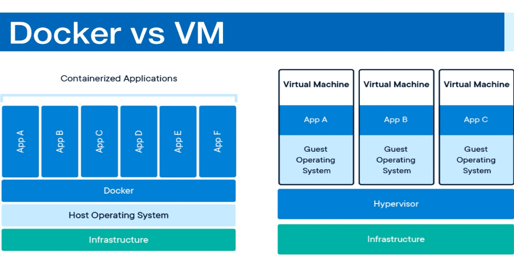

## Docker


### Docker 
* Tool for running applications in an isolated Environment
* Similar to Virtual Machine
* App run in same environmet
* Standard for Software deployment


#### Containers

Containers are an abstraction at the app layer that packages code and dependencies together. Multiple containers can run on the same machine and share the OS karnel with other containers each running as isolated processes in user space


#### Virtual Machines

Virtual Machines (VM) are an abstraction of physical hardware turning one server into many servers. The hyporviser alows multiple VMs to run on a single machine. Each VM includes a full copy of an operating systems, the applications and necessary libraries. 




### Commands


```bash

# List of containres
docker ps -a
docker ps

# Docker version
docker --version


```


### Pulling image


```bash

docker pull nginx

```


### Running Containers

```bash
docker run -d nginx:latest

docker stop <container-name>


docker ps
docker ps -a


docker run -d -p 8080:80 nginx:latest

# we can expose from multiple ports
docker run -d -p 8080:80 -p 3000:80 nginx:latest

docker rm $(docker ps -aq) # remove all containers
docker rm -f $(docker ps -aq)

# Naming containers

docker run -d -p 8080:80 nginx:latest --name website
docker stop website
docker start website


docker run --name website -v $(pwd):/usr/share/nginx/html:ro  -d -p 8000:80 nginx:latest

docker exec -it <container_name> bash
```


## Dockerfile


```bash

docker build --tag website:latest .


docker run --name website -d -p 8000:80 website:latest


```